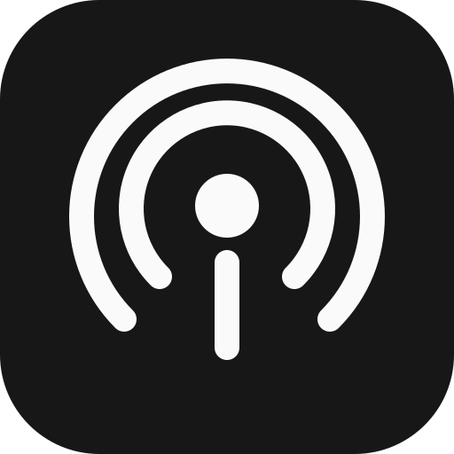

<p align="center"></p>

<h1 align="center">Subcast</h1>

<p align="center">
  The podcasts you pay for, in the podcast app you already use.<br>
  Private feeds of your subscriber podcasts, on your own Cloudflare account.
</p>

<p align="center">
  <a href="https://deploy.workers.cloudflare.com/?url=https://github.com/federicoodorizzi/subcast"></a>
</p>

Some publishers keep their subscriber podcasts inside their own apps or websites. Subcast signs in
with your subscription, checks for new episodes every 30 minutes, and gives you a private feed
address for each show. Add that address to Apple Podcasts, Overcast or any other podcast app.
It runs on your own Cloudflare account, usually on the free plan.

## Supported publishers

| Publisher | What you need | Shows |
| --- | --- | --- |
| [Internazionale](https://www.internazionale.it/podcast) | A digital subscription | Every show on internazionale.it/podcast, including the subscriber-only ones such as *A voce* |
| [Il Post](https://www.ilpost.it/podcasts/) | A subscription | Every show in the Il Post app, including the subscriber-only ones such as *Morning*, *Globo* and *Tienimi Bordone* |

Adding a publisher is one file: see [Adding a publisher](#adding-a-publisher).

## How it works

- **Feeds carry no audio.** Each episode in a feed links to the publisher's own audio file, which
  your podcast app downloads directly. The Worker only serves the feed (a small XML file), so it
  stays fast and free.
- **Every 30 minutes**, a Cron Trigger signs in to each account (only when its session is about to
  expire), fetches each show you follow, and saves new episodes to a D1 database. Episodes stay in
  the feed even after the publisher's page stops listing them.
- **Each show gets its own feed.** Podcast apps treat one feed as one show, with its own artwork,
  episode list, notifications and settings. A single feed per publisher would mix every show into
  one. On a phone, tap a show and then **Open in Apple Podcasts**, so following a show takes one tap.
- **Each feed address holds a 256-bit secret token**, as in
  `https://podcasts.example.com/feed/<token>/a-voce.xml`. Apple Podcasts can't send a password
  with a feed, so this token is what keeps the feed private. Anyone who has the address can
  listen, so keep it to yourself. If it leaks, choose **New address** and the old one stops
  working at once.
- **Artwork is served at the size podcast apps expect.** Every show and every episode carries an
  `itunes:image` pointing at `/feed/<token>/art/...`. That route passes through a publisher's picture
  when it's already square and at least 1400 px, and otherwise resizes it with
  [Cloudflare Images](https://developers.cloudflare.com/images/transform-images/bindings/). Each
  picture is resized once and then cached, well within the free plan's 5,000 resizes a month. Without
  an episode image, Apple Podcasts falls back to the thumbnail inside the MP3.
- Every feed is marked `<itunes:block>Yes</itunes:block>`, so it never appears in Apple's public
  directory.

## Security

- **Publisher credentials** are encrypted with AES-256-GCM before they go into D1. Each one is
  bound to its own row, so a copied ciphertext won't decrypt anywhere else. The key is derived
  from `APP_SECRET`, a Worker secret that the first deploy generates and Cloudflare never shows
  again. Someone who could read your database would see only ciphertext.
- **The admin pages** ask for `ADMIN_PASSWORD`. They use a signed, `HttpOnly`, `SameSite=Strict`
  cookie, reject any POST that comes from another origin, and stop accepting passwords after 10
  wrong attempts in 15 minutes. Changing `ADMIN_PASSWORD` signs everyone out.
- **Feed tokens are stored as SHA-256 hashes** for lookup. An encrypted copy is kept only so the
  admin page can show you the address again.
- **Logs never include a token.** Cloudflare's invocation logs record every request URL, so this
  Worker turns them off (`observability.logs.invocation_logs: false`). Its own log lines never
  contain a token.
- **Personal use only.** Most subscriptions, Internazionale's and Il Post's included, allow personal
  use only and no redistribution. Don't share your feeds.

## Deploy

### With the button

1. Click **Deploy to Cloudflare** above. Cloudflare copies this repository to your GitHub or
   GitLab account, creates the Worker and its D1 database, and asks for an **admin password**.
2. Once it has deployed, open the Worker's address (`https://subcast.<you>.workers.dev`) and
   sign in with that password.
3. Connect a publisher, sign in with your subscriber email and password, tick the shows you want,
   and choose **Add**.
4. Tap a show, then **Open in Apple Podcasts**. Or copy its address and, in Apple Podcasts, choose
   **Library → ⋯ → Follow a Show by URL** (on a Mac: **File → Follow a Show by URL**).

Every later push to your copy deploys it again. The build runs `pnpm run deploy`
([`scripts/deploy.ts`](scripts/deploy.ts)), which creates `APP_SECRET` on the first deploy and
leaves it alone afterwards.

> The button needs a public repository. To deploy a private copy, use the Cloudflare dashboard's
> **Workers & Pages → Create → Import a repository** with `pnpm run deploy` as the deploy command,
> or deploy from your own machine as below.

### From your machine

```sh
pnpm install
pnpm exec wrangler login
ADMIN_PASSWORD='choose-a-long-one' pnpm run deploy
```

If you leave out `ADMIN_PASSWORD`, the script generates one and prints it once.

### A custom domain

In the dashboard, open the Worker's **Settings → Domains & Routes → Add → Custom domain**, and
enter a hostname on a zone in your account, such as `podcasts.example.com`. Feed addresses follow
whichever address you use to open the admin pages.

### Your own settings

To deploy from your machine with settings of your own, create `wrangler.local.json`, which git
ignores. Its top-level fields replace the ones in `wrangler.jsonc`:

```json
{
  "name": "my-subcast",
  "d1_databases": [{ "binding": "DB", "database_name": "my-subcast" }],
  "routes": [{ "pattern": "podcasts.example.com", "custom_domain": true }]
}
```

Keep a Worker's name once it has deployed. Its `APP_SECRET` belongs to that Worker, and a new name
means a new Worker with a new secret, which can't read the credentials the old one saved.

## Develop

```sh
pnpm install
cp .dev.vars.example .dev.vars   # then fill in ADMIN_PASSWORD and APP_SECRET (openssl rand -hex 32)
pnpm dev                         # the app and the Worker together, http://localhost:5173
pnpm check                       # typecheck, tests, and a build
```

The repo holds two halves, built together by Vite with the Cloudflare plugin:

- `src/`: the Worker. It serves the feeds at `/feed`, a JSON API at `/api`, and the cron job.
- `app/`: the admin app, written in React with [shadcn/ui](https://ui.shadcn.com) components. Vite
  builds it into static files that the Worker serves. Add a component with
  `pnpm dlx shadcn@latest add <name>`.

The tests run inside workerd with a local D1, and use a made-up publisher
([`test/fixtures.ts`](test/fixtures.ts)), so they need no account and never contact a real site.

## Adding a publisher

1. Write `src/providers/<publisher>.ts`, exporting a `Provider` ([`src/providers/types.ts`](src/providers/types.ts)):
   - `credentialFields`: what the account form asks for.
   - `login(credentials, http)`: signs in and returns a session (opaque data and an expiry).
     It throws `CredentialsError` when the publisher turns the credentials down.
   - `listShows(http)`: the shows to offer in the picker.
   - `fetchShow(slug, session, http)`: the show and its newest episodes. It throws
     `SessionExpiredError` when the session no longer unlocks them, and the Worker then signs in
     again and retries once.
2. Add it to `providers` in [`src/providers/index.ts`](src/providers/index.ts).
3. Add tests with a made-up page or API response.

Use the `http` you're given rather than `fetch`. It sends a normal browser User-Agent, applies a
timeout, and lets the tests swap the publisher out.

## Costs

The free Workers plan covers this: one feed fetch per show every 30 minutes, plus whatever your
podcast apps request. A D1 database on the free plan holds up to 500 MB, which is years of episodes.

## Disclaimer

Subcast is an independent project. It isn't affiliated with, endorsed by or connected to
Internazionale, Il Post, Apple or any other publisher or app it works with. Their names are used only
to say what Subcast works with, and they remain their owners' trademarks.

Subcast is for listening to podcasts you already pay for, using your own account. You're responsible
for following your subscription's terms. Publishers can change their sites and apps at any time,
which can stop a provider working until it's updated.

## License

[MIT](LICENSE)
